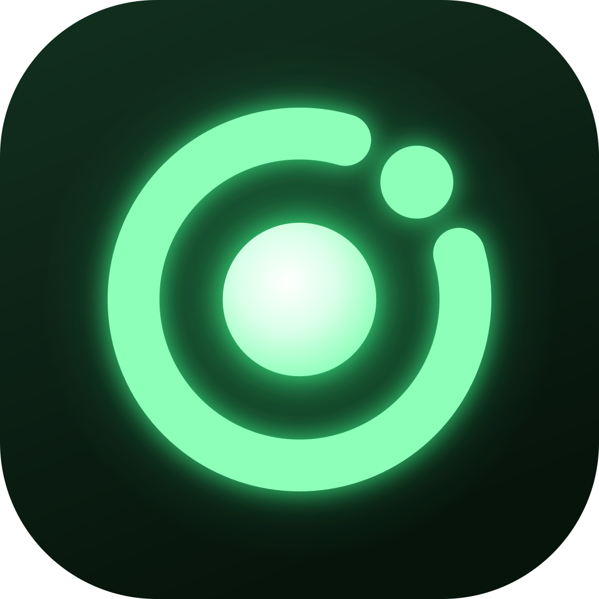

# Radium

Radium is an unofficial Linux fork of the
[Helium Browser](https://github.com/imputnet/helium) with a few extras on top,
most notably Vivaldi-style mouse gestures built into the browser: hold the right
mouse button over a page, draw a stroke, release.

> [!IMPORTANT]
> This is a personal fork. It is **not affiliated with or endorsed by Helium
> or imput**, and its builds are not signed with Helium's key. Please don't
> report problems with this build to the Helium project — open an issue here
> instead.

## What's different from Helium

- **Mouse gestures** (see below).

- **Up to 20 shortcuts on the new tab page** (Chromium's default is 10), by
  enabling Chromium's built-in shortcuts redesign
  ([`ntp-20-shortcuts.patch`](patches/helium/linux/ntp-20-shortcuts.patch)).
- **Recently closed tabs button**: one click on the toolbar button (clock icon)
  lists every recently closed tab, group and window; click one to reopen it.
  The browser now remembers the last 100 closed entries instead of 25. Unpin
  or re-pin it from the button's right-click menu or *Customize toolbar →
  Tools*
  ([`recently-closed-tabs-button.patch`](patches/helium/linux/recently-closed-tabs-button.patch)).
- **Radium name and icon** (see [Radium branding](#radium-branding)).

## Why not an extension?

Gesture extensions can't run on `chrome://` pages, the new tab page or pages
that are still loading. On Linux they're also clumsy because Chromium opens the
context menu as soon as the right button is *pressed*, so extensions usually
need a double right-click. Built into the browser, gestures work on every page
and a plain right-click still opens the normal context menu.

## Download

Grab the AppImage or tarball from the
[releases page](https://github.com/rafzzzzzz/radium-linux/releases).
x86_64 only. Builds lag behind official Helium releases, so you'll get security
fixes later than with official Helium.

Radium uses the same program name (`helium`), app id and profile folder
(`~/.config/net.imput.helium`) as Helium, so switching keeps your settings,
extensions and logins. It also means Radium and official Helium share one
profile: don't run both at the same time.

## Default gestures

| Gesture | Action |
|---|---|
| ← | Back |
| → | Forward |
| ↓ | New tab |
| ↑ | Close tab |
| ↑ ↓ | Reload |
| ↓ → | Bookmarks side panel |
| ← ↓ | Downloads |

A blue trail shows the stroke while you draw.

## Configuring gestures

Open `chrome://flags`, search for **Mouse Gesture Bindings**, enter your
bindings and restart. **Mouse Gestures** in the same page turns the feature
off entirely.

The format is comma-separated `gesture=action` pairs, where a gesture is a
sequence of `L`, `R`, `U`, `D` strokes:

```
L=back,R=forward,D=new-tab,U=close-tab,UD=reload,DR=bookmarks,LD=downloads
```

Setting the flag replaces the defaults, so include every gesture you want.
Invalid entries are skipped (run with `--enable-logging=stderr` to see why).

You can also pass it on the command line:
`helium --helium-mouse-gesture-bindings="L=back,R=forward"`

### Available actions

| Action | Does |
|---|---|
| `back`, `forward` | Navigate history |
| `reload`, `hard-reload`, `stop`, `home` | Page loading |
| `new-tab`, `close-tab`, `restore-tab`, `duplicate-tab`, `pin-tab` | Tabs |
| `next-tab`, `previous-tab` | Switch tabs |
| `new-window`, `new-incognito-window`, `close-window`, `minimize-window` | Windows |
| `fullscreen`, `zoom-in`, `zoom-out`, `zoom-reset` | View |
| `bookmarks` (side panel), `bookmark-manager`, `history`, `downloads` | Pages and panels |
| `devtools`, `toggle-vertical-tabs` | Other |

## How it works

Everything lives in one patch,
[`patches/helium/linux/add-mouse-gestures.patch`](patches/helium/linux/add-mouse-gestures.patch),
applied on top of Helium's own patches. It adds a pre-target event handler to
each browser window that catches right-button drags over web contents before
the page sees them, recognizes the stroke directions and runs the matching
browser command. A right-click without movement is replayed to the page so the
context menu still works.

Mouse gestures are only active over the page area; right-clicking tabs and the
toolbar is unchanged.

## Radium branding

The rebrand is a light one, done at build time so Helium updates stay easy to
merge:

- [`scripts/radium_substitution.py`](scripts/radium_substitution.py) runs after
  Helium's own Chrome → Helium renaming and renames the visible product name to
  Radium in every string and translation file. Phrases about Helium's own
  services and project ("Helium services", "Helium push server", …) keep the
  Helium name, because those servers are run by imput.
- `radium_resources` in [`scripts/shared.sh`](scripts/shared.sh) copies the
  Radium logos over every branding file Helium replaces. The logos are
  generated by
  [`resources/radium/make_branding.py`](resources/radium/make_branding.py).
- Internal names don't change: the `helium` binary, `helium://` pages, the
  `net.imput.helium` app id, the profile folder, `chrome://flags` descriptions
  and crash reporting all stay as in Helium.

## Building

Same as upstream helium-linux: run `scripts/docker-build.sh` from the repo
root (needs Docker, ~100 GB of disk and several hours), then
`package/docker-package.sh` to create the AppImage and tarball under
`build/release/`. See the
[upstream README](https://github.com/imputnet/helium-linux#building) for
details.

## License

GPL-3.0, like Helium. See [LICENSE](LICENSE). Code imported from
ungoogled-chromium keeps its BSD 3-Clause license
([LICENSE.ungoogled_chromium](LICENSE.ungoogled_chromium)). All credit for the
browser itself goes to the [Helium](https://github.com/imputnet/helium) and
[ungoogled-chromium](https://github.com/ungoogled-software/ungoogled-chromium)
projects.
